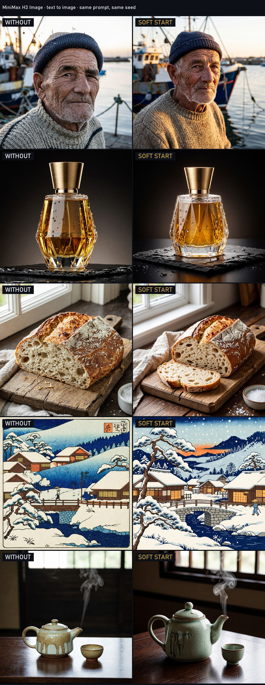
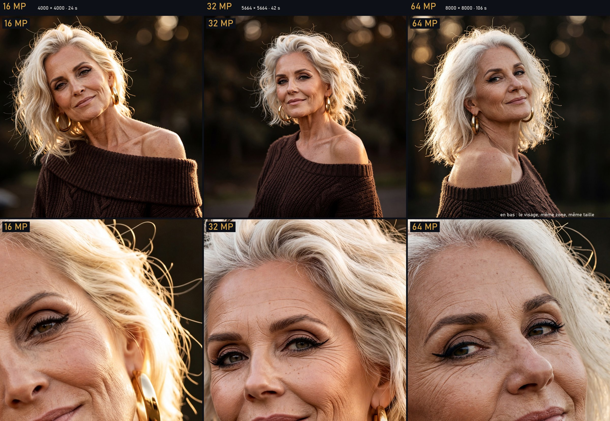

# AXIRIS · H3 Image Soft Start

A drop-in replacement for ComfyUI's **MiniMax H3 Image Conditioning** node that fixes the hard, over-contrasted look of
**text-to-image** renders. Same inputs, same outputs: swap the node, keep your workflow. *[Version française plus bas.](#francais)*

## Why

MiniMax H3 Image is built to edit from pictures. With text alone it renders hard: burnt contrast, an HDR look, plastic skin.
Showing it an **empty (black) picture during the first sampling steps** puts it back on its own ground: a softer, more
photographic render, with as much detail. The idea comes from **Kijai** ([ComfyUI-KJNodes](https://github.com/kijai/ComfyUI-KJNodes),
"text with empty image"); this pack is written from scratch and contains no line of KJNodes.

## How it works

- The black picture (512 × 512) is encoded **on its own**, with an empty prompt: its tokens do not depend on your prompt.
- They are placed **in front of** the text conditioning, which is encoded separately: the text never "sees" the picture.
- H3's token tags (image / text) are joined in the same order, so the model reads the sequence correctly.
- The picture is active on the **first 2 of 6 steps** (0 → 0.25), where the composition is decided; then the prompt alone.
- No VAE: the picture is not a reference to edit, it only conditions the text encoder.
- **With real reference pictures (an edit), the node is the core node, unchanged.**

Measured on our side: a graph with this node gives exactly the same image, to the pixel, as the core conditioning followed by
the separate *empty picture* node (int8 and bf16). On the same seed, the framing changes compared with the render without it:
the first steps decide the composition.

## Higher resolutions

The node accepts sizes up to 16384 px per side. H3 Image is trained around 16 MP, but it holds well above. Measured on an
RTX PRO 6000 (int8, 6 steps, power limit 600 W), same prompt and seed:

| Size | Pixels | Time |
|---|---|---|
| 16 MP | 4000 × 4000 | 22 s |
| 32 MP | 5664 × 5664 | 41 s |
| 64 MP | 8000 × 8000 | 104 s |

## Install

1. In `ComfyUI/custom_nodes/`: `git clone https://github.com/Axiris/ComfyUI-AXIRIS-H3-Image-Soft-Start`
2. Restart ComfyUI. Requires ComfyUI 0.45 or later (MiniMax H3 Image support).
3. In your workflow, replace **MiniMax H3 Image Conditioning** with **✦ AXIRIS · H3 Image Soft Start** — or open
   `workflows/MiniMax H3 Image - text to image (Soft Start).json` (the official template, with this node).

## Models

The node uses ComfyUI's own MiniMax H3 Image models (the example workflow also offers to download them):

| File | Folder | Link |
|---|---|---|
| `minimax_h3_image_pruned_int8_convrot.safetensors` (21 GB) | `models/diffusion_models/` | [Hugging Face](https://huggingface.co/Comfy-Org/MiniMax-H3-Image/resolve/main/diffusion_models/minimax_h3_image_pruned_int8_convrot.safetensors) |
| `qwen3vl_32b_minimax_h3_int8_convrot.safetensors` (25.3 GB) | `models/text_encoders/` | [Hugging Face](https://huggingface.co/Comfy-Org/MiniMax-H3/resolve/main/text_encoders/qwen3vl_32b_minimax_h3_int8_convrot.safetensors) |
| `minimax_h3_image_vae_fp16.safetensors` (1.2 GB) | `models/vae/` | [Hugging Face](https://huggingface.co/Comfy-Org/MiniMax-H3-Image/resolve/main/vae/minimax_h3_image_vae_fp16.safetensors) |
| `qwen3.5_9b_w4a8_gptq.safetensors` (7.3 GB, only for the prompt expander of the official template) | `models/text_encoders/` | [Hugging Face](https://huggingface.co/Comfy-Org/Qwen3.5/resolve/main/text_encoders/qwen3.5_9b_w4a8_gptq.safetensors) |

## Nodes

| Node | What it does |
|---|---|
| **✦ AXIRIS · H3 Image Soft Start** | Replaces the core conditioning. `image_vide` (on by default), `debut` / `fin` (the steps with the empty picture, 0 → 0.25), `taille` (side of the black picture, 512). |
| **✦ AXIRIS · H3 Image — image vide (premiers pas)** | The same effect as a separate node, between the core conditioning (without pictures) and the KSampler. |

---

# Français

Un remplaçant direct du node **MiniMax H3 Image Conditioning** de ComfyUI, qui corrige le rendu dur et trop contrasté
d'H3 Image en **texte seul**. Mêmes entrées, mêmes sorties : on change le node, on garde son workflow.

**Pourquoi.** H3 Image est fait pour éditer à partir d'images. En texte seul, il rend dur : contraste brûlé, aspect HDR, peau
plastique. Lui montrer une **image vide (noire) pendant les premiers pas** le remet sur son terrain : un rendu plus doux, plus
photo, avec autant de détail. L'idée vient de **Kijai** (ComfyUI-KJNodes, « text with empty image ») ; ce pack est écrit de zéro.

**Comment.** L'image noire (512 × 512) est encodée seule, avec un prompt vide, puis placée devant le prompt encodé à part : le
texte ne la « voit » jamais. Elle agit sur les 2 premiers pas sur 6 (0 → 0,25), là où se décide la composition, puis le prompt
seul. Pas de VAE. Avec de vraies images de référence (un edit), le node est le node d'origine, sans changement.

**Plus haut que 16 MP.** Jusqu'à 16 384 px de côté. Mesuré sur une RTX PRO 6000 (int8, 6 pas, 600 W) : 16 MP en 22 s,
32 MP en 41 s, 64 MP en 104 s.

**Modèles.** Ceux de ComfyUI pour MiniMax H3 Image (le workflow d'exemple propose aussi de les télécharger) :
[le modèle int8](https://huggingface.co/Comfy-Org/MiniMax-H3-Image/resolve/main/diffusion_models/minimax_h3_image_pruned_int8_convrot.safetensors) dans `models/diffusion_models/`,
[l'encodeur de texte](https://huggingface.co/Comfy-Org/MiniMax-H3/resolve/main/text_encoders/qwen3vl_32b_minimax_h3_int8_convrot.safetensors) dans `models/text_encoders/`,
[le VAE](https://huggingface.co/Comfy-Org/MiniMax-H3-Image/resolve/main/vae/minimax_h3_image_vae_fp16.safetensors) dans `models/vae/`,
et [le Qwen 3.5 9B](https://huggingface.co/Comfy-Org/Qwen3.5/resolve/main/text_encoders/qwen3.5_9b_w4a8_gptq.safetensors) dans `models/text_encoders/`, seulement pour le développeur de prompt du template officiel.

**Installer.** Dans `ComfyUI/custom_nodes/` : `git clone https://github.com/Axiris/ComfyUI-AXIRIS-H3-Image-Soft-Start`, redémarrer ComfyUI (0.45 ou plus), remplacer le node
d'origine par **✦ AXIRIS · H3 Image Soft Start**, ou ouvrir le workflow du dossier `workflows/`.
